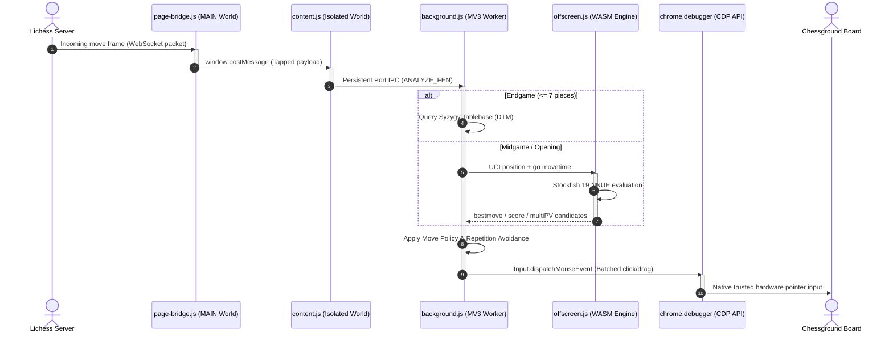

# FrameZero (MV3)

<p align="center">
  <strong>Sub-millisecond WebAssembly chess engine & automated analysis client for Lichess.</strong><br>
  Intercepts round WebSocket packets on the wire, computes optimal lines with Stockfish 19 NNUE & Syzygy Tablebases, and executes replies via hardware-level Chrome DevTools Protocol events.
</p>

<p align="center">
  <a href="manifest.json"></a>
  <a href="LICENSE"></a>
  <a href="engine/"></a>
  <a href="lib/tablebase.js"></a>
  <a href="https://github.com/Mackming/framezero/actions"></a>
</p>

---

> [!IMPORTANT]
> **Fair Play & Research Disclaimer:** FrameZero is an experimental systems engineering study exploring WebAssembly performance in Chrome Manifest V3 offscreen documents, real-time WebSocket protocol decoding, and CDP browser automation. It is designed for analysis boards, offline study, and private testing. Using computer assistance in live rated games against human players violates Lichess Terms of Service and fair-play regulations.

---

## ⚡ Why FrameZero?

Traditional browser chess bots rely on `MutationObserver` to watch the DOM. By the time piece transforms update, animations settle, and debounce loops fire, **200–300 ms of clock time is already lost**.

**FrameZero operates at wire speed:**
* 📡 **WebSocket Interception:** Taps incoming game frames directly at `document_start` before Lichess even renders the move.
* 🧠 **Stockfish 19 NNUE:** Powered by WebAssembly with pthreads multithreading and a 512 MB persistent transposition table.
* ♟️ **Syzygy Endgame Tablebases:** Positions with $\le 7$ pieces skip engine search entirely for instant, mathematically optimal conversion (DTM).
* 🖱️ **Hardware-Level Click Dispatch:** Emits trusted native input events via `chrome.debugger` (Chrome DevTools Protocol), bypassing synthetic DOM event blocks (`isTrusted: true`).
* 🎯 **Dynamic Playstyles:** Select from 7 tactical personalities (Aggro, Trap, Greedy, Chaos, Teasing, Drawish, or Best Move) using MultiPV evaluation.

---

## 🏗️ Architecture & Data Flow

FrameZero decouples DOM observation, engine computation, and hardware click dispatching into specialized execution contexts:



---

## 🎮 Features Matrix

### 1. Engine Options
| Engine | Net | Mechanism | Purpose |
| :--- | :--- | :--- | :--- |
| **Stockfish 19 (Default)** | `nn-61e7af4bb97d.nnue` (1.1 MB) | ES Module + `setNnueBuffer` | Size-optimized NNUE that fits in L3 CPU cache; highest NPS |
| **Stockfish 18 Lite** | 5.2 MB baked inside WASM | Web Worker (`pthreads`) | Robust multithreaded fallback |
| **Stockfish 18 Single** | 5.2 MB baked inside WASM | Single-threaded Worker | Zero-dependency fallback for environments without shared memory |
| **Syzygy Tablebase** | 7-Piece Endgame Tablebase | REST API (`tablebase.lichess.ovh`) | Instant DTM mate conversion inside $\le 7$ pieces |

### 2. Move Personalities & Styles
Configure how FrameZero behaves during games via MultiPV analysis:

| Style | MultiPV | Behavior |
| :--- | :---: | :--- |
| **Best Move** | 1 | Maximum tactical accuracy; plays the top engine choice. |
| **Chaos** | 5 | Randomly chooses among near-equal moves within centipawn tolerance. |
| **Aggressive** | 5 | Prioritizes checks, pins, and captures whenever sound. Pairs with gambit openings. |
| **Greedy** | 5 | Grabs material aggressively without spoiling positional soundness. |
| **Trap** | 5 | Baits opponents: plays moves that look weak at shallow depth (6 ply) but win deeply. |
| **Teasing** | 6 | Holds an evaluation lead ($+0.80$ to $+2.50$) while deliberately avoiding conversion. |
| **Drawish** | 6 | Actively steers evaluations toward dead level ($0.00$). |

---

## 🚀 Quick Start

### 1. Installation
1. Clone or download this repository:
   ```bash
   git clone https://github.com/Mackming/framezero.git
   ```
2. Open Google Chrome (or any Chromium browser) and navigate to `chrome://extensions`.
3. Enable **Developer mode** (toggle in the top-right corner).
4. Click **Load unpacked** and select the `framezero` root directory.

### 2. Usage
1. Open any game or [Lichess Analysis Board](https://lichess.org/analysis).
2. The **FrameZero** floating HUD will automatically mount in the upper-right corner.
3. Toggle the bot on/off anytime using **`Alt + B`** or via the HUD switch.

---

## 🔍 In-Depth Systems Design

<details>
<summary><strong>⏱️ Latency Breakdown: WebSocket Tap vs. DOM Polling</strong></summary>

<br>

| Step | Traditional DOM Bot | FrameZero |
| :--- | :---: | :---: |
| Mutation debounce | 70 ms | **0 ms** (instant wire capture) |
| Animation settle poll | 200–280 ms | **0 ms** (decoded on arrival frame) |
| Board state derivation | ~10 ms | **0 ms** (exact FEN / SAN from server packet) |
| Worker cold-start delay | 30–100 ms | **0 ms** (persistent port keeps worker warm) |
| CDP input dispatch | 6 awaited round trips | **1 batched round trip** |
| Total Overhead Before Engine Search | **~350 ms** | **< 5 ms** |

</details>

<details>
<summary><strong>🧩 Persistent Engine Host & Memory Lifecycle</strong></summary>

<br>

Chrome MV3 Service Workers lack the `Worker` constructor and terminate after 30 seconds of inactivity. Destroying and recompiling a 7 MB WebAssembly binary on every move incurs massive latency.

* **Offscreen Document Host:** The engine worker runs inside an offscreen document (`offscreen.html`), keeping the WASM binary and 512 MB Transposition Table resident in memory.
* **Persistent Connection:** `content.js` establishes a long-lived `chrome.runtime.connect` port with keep-alive heartbeats, resetting the worker's idle countdown.
* **Auto-Teardown Alarm:** An idle alarm tears down the offscreen document after 20 minutes of inactivity, reclaiming ~128 MB+ of linear RAM when play concludes.

</details>

<details>
<summary><strong>📊 Stockfish 19 vs. Stockfish 18 Benchmarks</strong></summary>

<br>

Measured across 5 tactical benchmark positions on a 2-thread budget:

| Think Time | SF19 (1MB Net) | SF18 (5MB Net) | Result |
| :---: | :---: | :---: | :--- |
| **100 ms** | 13.0 ply · 788k nps | 13.2 ply · 1076k nps | Level |
| **200 ms** | 15.0 ply · 832k nps | 15.0 ply · 1091k nps | Level |
| **500 ms** | 16.6 ply · 883k nps | 17.2 ply · 1088k nps | Level |
| **1000 ms** | 18.6 ply · 911k nps | 18.8 ply · 1077k nps | Level |
| **2000 ms** | **21.0 ply** · 878k nps | 19.8 ply · 949k nps | **SF19 +1.2 plies** |
| **5000 ms** | **24.6 ply** · 877k nps | 21.6 ply · 1056k nps | **SF19 +3.0 plies** |

*Conclusion:* The 1.1 MB size-optimized net fits inside L3 CPU cache, allowing SF19's selective search to compound as think times increase.

</details>

<details>
<summary><strong>🖱️ Hardware Click Injection via Chrome DevTools Protocol</strong></summary>

<br>

Synthetic JavaScript pointer events (`element.dispatchEvent`) set `isTrusted: false`, which Lichess actively ignores. FrameZero uses `chrome.debugger` to issue native `Input.dispatchMouseEvent` commands at browser level:
* **Drag-and-Drop:** Single smooth drag motion (source press $\to$ midpoint $\to$ target release), eliminating the 120 ms delay required between two separate clicks.
* **Promotion Resolution:** Detects Lichess's `<div id="promotion-choice">` dialog and dispatches precise coordinates to pick the promoted piece.

</details>

<details>
<summary><strong>📐 Responsive SVG Coordinate-Independent Overlay</strong></summary>

<br>

The visual overlay is rendered via a single `<svg viewBox="0 0 8 8">` stretched over the chessboard at `width: 100%; height: 100%`. Every coordinate is expressed in chessboard units (e.g., e4 = `(4.5, 4.5)`). It never requires resize event listeners, recalculations, or pixel polling.

</details>

---

## 🧪 Testing & Verification

FrameZero includes 13 Node.js test suites with mock DOM (`jsdom`) fixtures:

```bash
npm test
```

```text
PASS test/cpu-modes.test.js
PASS test/engines.test.js
PASS test/bench-positions.test.js
PASS test/socket-events.test.js
PASS test/tablebase.test.js
PASS test/fen-sources.test.js
PASS test/position-sync.test.js
PASS test/overlay.test.js
PASS test/promotion.test.js
PASS test/ui.test.js
PASS test/opening-book.test.js
PASS test/move-policy.test.js
PASS test/integration.test.js

500+ assertions passed, 0 failed
```

---

## 📄 License

This project is licensed under the **GNU General Public License v3.0 (GPL-3.0)**. Stockfish and its WebAssembly ports are GPLv3 software. See the [LICENSE](LICENSE) file for details.
