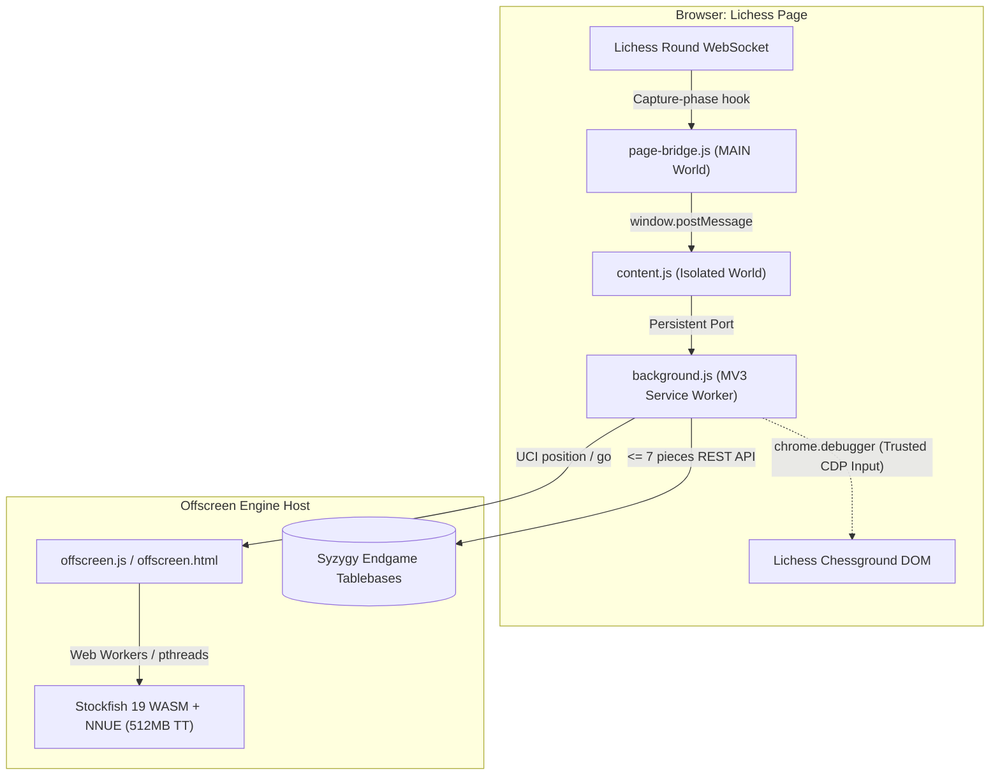

# FrameZero (MV3)

[](manifest.json)
[](LICENSE)
[](engine/)
[](lib/tablebase.js)
[](https://github.com/Mackming/framezero/actions)

**FrameZero** is a high-performance Manifest V3 Chrome extension that intercepts Lichess round WebSocket frames directly, evaluates positions with local WebAssembly Stockfish 19 (NNUE) or Syzygy 7-piece tablebases, and executes replies via hardware-level Chrome DevTools Protocol input dispatching.

> [!IMPORTANT]
> **Fair Play & Research Disclaimer:** This project is an experimental engineering demonstration of low-latency browser automation, WebAssembly performance in MV3 offscreen documents, and WebSocket packet decoding. It is intended for private games, analysis boards, and architectural research. Using computer assistance in live rated games against human players violates the Lichess Terms of Service and Fair Play Policy.

---

## Architecture Overview



Moves are detected by tapping the round WebSocket rather than by watching the
board, which is what makes it usable at bullet time controls: the frame that tells
Lichess a move was played is the same frame that tells this extension, so
detection happens before a single pixel has moved. See
[Detecting the opponent's move](#detecting-the-opponents-move).

## Layout

```
manifest.json                             MV3 manifest
background.js                             service worker: message router + UCI driver
offscreen.html / offscreen.js             hosts the Stockfish Web Worker
content.js                                board reader + analyzeCurrentPosition()
page-bridge.js                            MAIN-world script: socket tap + window.site
lib/chess.js                              chess.js 1.4.0 ESM bundle (web-accessible)
lib/fen-sources.js                        FEN extraction (pure, unit-tested)
lib/socket-events.js                      round-socket event parsing (pure, unit-tested)
lib/position-sync.js                      move derivation + debounce (pure)
lib/board-geometry.js                     square <-> board coordinate mapping
lib/overlay.js                            SVG move indicator (pure, unit-tested)
lib/promotion.js                          promotion chooser lookup (pure, unit-tested)
lib/engines.js                            engine catalogue + fallback order (pure, unit-tested)
lib/bench-positions.js                    engine benchmark positions + stats (pure, unit-tested)
test/                                     node tests, no Chrome required
lib/tablebase.js                          Syzygy endgame lookup (pure, unit-tested)
engine/sf_19_smallnet*.js/.wasm           SF19, lichess build — default (0.5 MB each)
engine/nn-61e7af4bb97d.nnue               SF19 net, loaded at runtime (1.1 MB)
engine/stockfish-18-lite.js               SF18 Lite, pthreads (31 KB)
engine/stockfish-18-lite.wasm             SF18 Lite, pthreads, net baked in (6.8 MB)
engine/stockfish-18-lite-single.js        SF18 Lite, single-threaded fallback (20 KB)
engine/stockfish-18-lite-single.wasm      SF18 Lite, single-threaded fallback (7.0 MB)
```

`engine/` comes from the official `nmrugg/stockfish.js` **v18.0.0 release assets** —
the repo's `src/` tree holds only C++ sources; the built artifacts ship as release
downloads and on npm. The two files must stay side by side: the glue derives the
`.wasm` URL from its own script URL.

### Upgrading the engine

The whole build is the unit of upgrade — there is no net to swap on its own. The
NNUE (`nn-9067e33176e8.nnue`, 5.2 MB) is embedded in the `.wasm`, and the network
architecture is a compile-time template parameter, visible in the binary as
`NetworkArchitecture<128,15,32>` / `<256,15,32>`. A net built for a different
architecture cannot be loaded into it, so "just update the net" is never the move.

When `nmrugg/stockfish.js` publishes a new major, the swap is:

1. Replace the four files in `engine/` with the new release assets.
2. Point `THREADED_ENGINE` and `SINGLE_ENGINE` (`offscreen.js`, top of file) at the
   new filenames.

Nothing else in the codebase names an engine version. Everything downstream speaks
plain UCI over a `Worker`, which has not changed across Stockfish majors.

### Choosing an engine

Two engines ship, picked from **Engine** in the panel and remembered per browser:

| | net | supplier | loads as |
|---|---|---|---|
| **Stockfish 19** (default) | `nn-61e7af4bb97d.nnue`, 1.1 MB, separate file | `@lichess-org/stockfish-web` | ES module + `setNnueBuffer` |
| Stockfish 18 | 5.2 MB, compiled into the `.wasm` | `nmrugg/stockfish.js` | `new Worker` + postMessage |

A third build carrying SF19's full 93.9 MB net (`nn-1a298aa575a0.nnue`, the engine's
own `EvalFileDefaultName`) was shipped, benchmarked and removed — the numbers are
below. If you ever restore it, note that a HEAD against the Stockfish net server
reports ~75 MB for that file: that is the *compressed* length, and lichess's "94MB"
label is the honest one.

The default is the middle one, and it is *smaller* than the SF18 build it replaces:
SFNNv16 retired the dual big/small net design, and the 1.1 MB net is the
size-optimised one lichess serves as their own default browser engine (they mark it
`preferred` and make the 94 MB build opt-in).

### Which net is actually stronger here — measured

Published figures cannot answer this. The "up to 44 Elo" in SF19's release notes is
SF19 vs SF18, both on standard nets, at standard time controls, on native hardware —
three substitutions away from "which net wins at bullet speeds in WASM". So
**⏱ Benchmark engines** in the panel measures it instead: every engine over the same
five positions (`lib/bench-positions.js`) at the configured think time, reporting
average depth and nps.

Measured on a 2-thread budget (average depth across the five positions, nps in
thousands). The 94 MB column is kept as the record of why that build is no longer
shipped:

| think time | SF19 94MB | SF19 1MB | SF18 |
|---|---|---|---|
| 100 ms | 12.2 · 414k | 13.0 · 788k | **13.2** · 1076k |
| 200 ms | 14.0 · 436k | **15.0** · 832k | **15.0** · 1091k |
| 500 ms | 14.6 · 445k | 16.6 · 883k | **17.2** · 1088k |
| 1000 ms | 17.0 · 447k | 18.6 · 911k | **18.8** · 1077k |
| 2000 ms | 18.2 · 440k | **21.0** · 878k | 19.8 · 949k |
| 5000 ms | 22.2 · 434k | **24.6** · 877k | 21.6 · 1056k |

Two conclusions, both of which contradict a reasonable prior guess:

**The 94 MB net never wins.** It runs at half the nps of the 1 MB net at every single
time control — 414–447k against 780–911k, almost perfectly flat — and lands 0.8 to
2.8 plies shallower. The obvious expectation is that a better evaluation eventually
repays its cost once there is time to reach depth, and the two-point stretch from
500 ms to 1000 ms looks like the start of exactly that. It is not: extending to
2000 ms and 5000 ms the gap goes back to −2.8 and −2.4. There is no crossover in any
range this extension plays at. Don't read a trend off two points.

**SF19 scales better with time than SF18 does.** Below ~1000 ms the two are level
(SF18 nominally ahead by 0.2–0.6 plies, which is noise, and depth is not strictly
comparable across major versions anyway). From 2000 ms up SF19 pulls clearly ahead —
+1.2 plies at 2 s, +3.0 at 5 s — because its more selective search compounds as it
goes deeper. That is a large enough margin to survive the cross-version caveat.

So Stockfish 19 is the default and the right choice at every speed: level with SF18
at bullet, decisively better for analysis. The 94 MB build was deleted rather than
left as an option nobody should pick.

**The rule this leaves behind**, for the next net that comes along: the threshold is
whether the net fits in CPU cache, not whether it is small. SF18's 5.2 MB net is
five times the size of the 1.1 MB one and ran *faster* than both — all three fit
except the 94 MB one, and only that one fell off a cliff. Below the cache line,
pick the better net; above it, size overwhelms everything else. Two things would
move that line: a CPU with a very large L3 (AMD's X3D parts carry 96–128 MB), or
WebAssembly gaining SIMD wider than its current 128 bits. More threads will not —
they contend for the same memory bandwidth and make a cache-missing net relatively
worse.


The two builds do not load the same way, which is why `lib/engines.js` exists and
why `offscreen.js` is written against a `{ send, dispose }` link rather than a
`Worker`. SF19's builds are pthread builds with no single-threaded variant, so
without `SharedArrayBuffer` they cannot instantiate at all; `engineCandidates()`
therefore skips them outright rather than spending a bring-up timeout finding out,
and every candidate list ends with the SF18 single-threaded build, which needs
nothing and always runs. If the engine that came up is not the one that was asked
for, the panel and the log both say so rather than quietly playing weaker.

`minMem` in lichess's engine list is in **64 KB wasm pages, not megabytes** — 1536
pages is a 96 MB initial allocation against the same ~2 GB ceiling our SF18 build
already declares, so switching engines barely moves the memory floor. What moves is
the resident net, and this one is 4 MB smaller than the one it replaces.

## Playing strength

Three separate things decide how well it plays, and they are not equally
important. In rough order of Elo per megabyte and per millisecond:

### 1. Threads — the largest lever, and it is free

`engine/stockfish-18-lite.js` is the pthreads build; `-single` is the same
engine with the same net compiled without threading. Running on one core when
several are available is worth well over a hundred Elo at a fixed think time,
which dwarfs anything else on this list. The threaded `.wasm` is 6.8 MB against
the single build's 7.0 MB, so it is not even a size trade.

`offscreen.js` asks for `hardwareConcurrency - 1` threads, capped at 8. One core
is deliberately left alone: this document shares the machine with the Lichess
tab, the content script reading the board and the debugger dispatching clicks,
and starving those shows up as latency on exactly the path the socket tap
exists to keep short.

Threads need a shared `WebAssembly.Memory`, which needs `crossOriginIsolated`,
which is why the manifest carries `cross_origin_embedder_policy` and
`cross_origin_opener_policy`. Whether Chrome honours those on an *offscreen
document* is not something this code can know in advance, so it does not
assume: `threadBudget()` checks `SharedArrayBuffer` **and**
`crossOriginIsolated`, the threaded build is brought up with a timeout and an
`error` handler that both reject, and a rejection falls back to the
single-threaded build rather than failing to start.

The panel says which one won, on every bot start:

```
Engine: stockfish-18-lite — 3 threads          <- threading live
Engine: stockfish-18-lite-single — 1 thread    <- fell back (logged as a warning)
```

The offscreen console says *why* it fell back, including the
`crossOriginIsolated` value it saw.

The pthreads build self-hosts its workers, which is worth knowing because the
release publishes no `stockfish.worker.js`: its `locateFile` returns
`origin + pathname + '#' + wasmUrl + ',worker'` for any request that is not the
`.wasm`, so every pthread worker it spawns is that same file loaded with a hash
marker. Nothing extra to ship. (`worker-src` carries `blob:` because
emscripten's bootstrap can hand a worker a blob URL instead.)

### 2. Tablebases — not stronger, *perfect*

Inside seven pieces, every position is solved. A search is an estimate, and in
an endgame it fails in a specific way: the evaluation is right and the moves are
not, because the win is forty quiet moves deep behind a horizon no amount of
pruning reaches at bullet time.

This build cannot load Syzygy files itself — the glue exposes no `SyzygyPath`
and has no filesystem to point at — so `lib/tablebase.js` asks Lichess's public
server. Measured at ~430 ms cold, and the response carries `Cache-Control:
max-age=1209600` so repeats are free. **On a hit the search is skipped
entirely**, which makes an endgame move both faster than it was (~430 ms rather
than a full think) and provably optimal.

A miss costs a clock-scaled timeout and nothing else, and misses are cached so a
position with no data is not re-waited-for on every repetition. Anything at all
going wrong — offline, rate-limited, a plain-text error body for an illegal FEN,
a stalemate whose `moves[]` is empty — returns null and falls through to the
engine.

The one thing that had to be right is the sign. A `category` on an entry in
`moves[]` describes the position *after* the move, so it is stated from the
opponent's side: **a move marked `loss` is the move to play.** Inverted, that
would not crash or look wrong — it would quietly play the fastest way to lose,
in exactly the positions the tablebase was added to make perfect. Hence
`outcomeForMover()` and the assertions in `test/tablebase.test.js` that pin it
down, plus a captured real response as a fixture so the parser is tested against
what the server sends rather than what the docs describe.

Ranking is outcome first, then speed: fastest conversion when winning, slowest
capitulation when losing. The second half is not sentiment — a lost position
played for maximum length still has to be converted, and on a bullet clock it
often is not. Distance uses DTM over DTZ, because DTZ counts to the next capture
or pawn move and can rank a slower mate first.

### 3. CPU budget

Two dials, not one, and the second is the one that gets missed.

Thread count sets how *high* CPU use goes. The **duty cycle** sets how often it
is that high — and the prewarm changed that from "about half the game" to
"essentially all of it", because it fills the opponent's whole turn with a
search. Cutting threads alone lowers the ceiling while leaving the engine busy
throughout; cutting the prewarm alone idles half the time at full tilt. So
`lib/cpu-modes.js` sets both:

| Mode | Threads (4-core) | Prewarm | CPU while playing | vs. Max |
|---|---|---|---|---|
| **Eco** | 1 | off | ~25%, and only while thinking | ~-100 Elo |
| **Balanced** *(default)* | 2 | 2 s | ~50% in short bursts | ~-40 Elo |
| **Max** | 3 | 20 s | ~75% continuously | — |

`threadCap` is a ceiling, not a request: the live number is
`min(threadCap, cores - 1, 8)`, so Max means something sensible on a two-core
laptop as well as a sixteen-core desktop, and one core is always left for the
browser to render the board and dispatch clicks with.

Changing mode takes effect on the current game. Stockfish rebuilds its thread
pool on `setoption name Threads`, which is only safe between searches, so
`applyCpuMode()` goes through the same `serialize` queue and `quiesce` as a
search takeover — doing it underneath a running search is how you get a
`bestmove` from a search that no longer exists.

Balanced is the default rather than Max on purpose: Max keeps the engine
searching for almost the whole game, which is worth opting into rather than
inheriting.

### 4. The net, and MultiPV

The lite net is embedded in the `.wasm` (no `EvalFile` option), so swapping it
means swapping builds. The full-net build is **107.8 MB** — worth perhaps 50–100
Elo, which makes it the *least* efficient of these three levers by a wide
margin. Dropping `stockfish-18.js`/`.wasm` into `engine/` and pointing
`THREADED_ENGINE` at it is all it would take.

Far more likely to be costing real strength: **MultiPV**. Every style except
`best` asks for 5–6 candidate lines, which cripples the engine's pruning and is
worth several plies of depth. `trap` is worse again — it runs a *second*,
shallower search. If maximum accuracy is the goal, `best` is the only style that
gets the engine's full strength; the others trade it for character on purpose.

`Hash` is 256 MB (up from Stockfish's own default of 16), which the prewarm
depends on: the table is what carries work from the opponent's clock into our
search.

## Load it

1. `chrome://extensions` → enable Developer mode → **Load unpacked** → this folder.
2. Open any page, open DevTools, and in the console's **context dropdown**
   (top-left of the Console panel) select this extension — `content.js` runs in an
   isolated world, so the function is not on the page's own `window`.
3. Run:

```js
await analyzeCurrentPosition('rnbqkbnr/pppppppp/8/8/8/8/PPPPPPPP/RNBQKBNR w KQkq - 0 1')
// [chess-engine] bestmove e2e4 (ponder e7e6) — white to move, depth 10, eval 0.32 pawns
//   pv: e2e4 e7e6 d2d4 d7d5 b1c3 d5e4 c3e4
```

## Reading the board from Lichess

`content.js` exposes these on the isolated world's global object:

| | |
|---|---|
| `board` | a chess.js `Chess` instance — the working position |
| `ready` | promise, resolves to `board` once chess.js has loaded |
| `initBoardFromDOM(opts?)` | read the page's position and load it into `board` |
| `getCurrentFEN()` | `board.fen()` |
| `debugFenSources()` | `console.table` of every source and what it produced |
| `readBoardFen(opts?)` | read the page's FEN **without** touching `board` |
| `analyzeBoard(opts?)` | `initBoardFromDOM()` then analyse the result |
| `startAutoAnalysis(opts?)` | watch the board, analyse on every change |
| `stopAutoAnalysis()` | disconnect the observer |
| `markOurMove(ms?)` | suppress the observer for `ms` (default 1200) |
| `drawBestMove(uci, opts?)` | draw an indicator for a move by hand |
| `clearIndicator()` | remove whatever is drawn |
| `setIndicators(on, opts?)` | toggle indicators, pick `via` |
| `isOurMove` | read/write suppression flag |
| `lastFenSource` | which source the last read used |

```js
await ready
await initBoardFromDOM()
// [chess-engine] board <- r1bq1rk1/pp2ppbp/... w - - 0 1
//   source: rendered-pieces  [turn/castling/counters defaulted - placement only]
getCurrentFEN()
await analyzeBoard()
```

`board` is created asynchronously because chess.js arrives via dynamic import, so
`await ready` before touching it on a cold page.

### Two corrections to the obvious approach

Both FEN sources named in the original brief turn out not to work as expected, so
`initBoardFromDOM()` tries a layered set of sources instead.

**`<cg-board>` has no `data-fen` attribute.** Fetching `lichess.org/analysis` shows
the element rendered bare — `<cg-board>` with no attributes at all, and zero
occurrences of `data-fen` anywhere in the document. What Lichess *does* expose is
`data-state="<fen>,<orientation>,<lastmove>"` on mini-boards, where the FEN is
often the 2-field short form (`1Q6/7p/8/3k2P1/8/6PP/7K/8 b`) rather than a legal
6-field one. `normalizeFen()` widens those with `w - - 0 1` defaults and reports
`complete: false` so you know the trailing fields were invented.

**`window.lichess` is now `window.site`, and a content script cannot see it.**
Content scripts run in an isolated world with their own global object; page globals
are simply not reachable from there. Reading it needs code running in the page, so
`page-bridge.js` is registered as a second content script with `"world": "MAIN"`
(restricted to `*://lichess.org/*`) and answers a `window.postMessage` request from
`content.js`. It probes known paths first, then does a bounded breadth-first scan
for a `fen` property, and only ever reads.

### Source priority

`lib/fen-sources.js` tries, in order, and uses the first that yields a valid FEN:

1. **`data-fen`** — kept first as asked; costs nothing, and other sites do use it.
2. **`data-state`** — verified real on Lichess mini-boards; FEN is field 0.
3. **`fen-input`** — the analysis board's FEN box (`.analyse__underboard .fen input`).
4. **`window.site`** — whatever `page-bridge.js` found in the MAIN world.
5. **`rendered-pieces`** — reconstruct the placement from the `<piece>` elements
   chessground actually drew.

The last one is the only source that is always current on every board, including
live games. It derives each square from bounding boxes rather than parsing the
`transform` string, handles flipped boards via `.cg-wrap.orientation-black`, skips
drag ghosts and fading captures, and picks the **largest board that has pieces** —
a Lichess page frequently has several `<cg-board>` elements and the first in
document order is often a sidebar mini-board. It can only see piece placement, so
turn, castling, en passant and the move counters fall back to defaults.

Pass `prefer` to force one: `initBoardFromDOM({ prefer: 'rendered-pieces' })`.

## Detecting the opponent's move

Two paths, in priority order. The socket tap is the one that runs in a real game;
the board watch is the fallback and the analysis-board path.

### The socket tap (primary)

`page-bridge.js` runs in the page's MAIN world at `document_start` — before
Lichess's own bundle exists — and replaces `window.WebSocket` with a wrapper that
adds a capture-phase `message` listener to every socket the page opens. The native
constructor still does the work and the prototype chain is re-pointed at it, so
`instanceof`, the readyState constants and any subclassing behave exactly as
before; nothing is intercepted or rewritten, and nothing is ever sent.

Relevant frames are pushed to the content script as
`{ __cbe: 'SOCKET', at, event: { t, d } }`, with `t: 'b'` batches unwrapped into
their members. `lib/socket-events.js` — which lives in the isolated world where
chess.js is, and is therefore unit-tested — turns those into a decision.

Why this is not just faster but *more accurate* than reading the board:

| | board watch | socket tap |
|---|---|---|
| the move | derived by brute force from a placement diff | `uci` and `san`, stated |
| side to move | inferred from a highlight, or defaulted | exact, from `ply` parity |
| castling / en passant / counters | inferred, or defaulted away | exact, replayed through chess.js |
| our colour | guessed from board orientation | stated by the server, via `dests` |
| the clock | clock text, rounded to the second | exact ms, from `clock` |
| when it is known | after the ~200 ms move animation settles | before the animation starts |

`dests` deserves the emphasis: Lichess sends a legal-destination map only to the
client it is expecting a move from, so its presence on the event that hands over
the turn is the server stating which side this browser plays. That replaces the
board-orientation guess — which spectators, analysis boards and the flip button
all break — and it is known before we have played anything.

The server's echo of our *own* move does double duty: it confirms the click landed
(so there is nothing to poll for), and it lifts the `markOurMove()` suppression the
instant the truth arrives rather than when a timer says so.

### Spending the opponent's clock

While the opponent is on the clock, `PREWARM` starts a bounded search and throws
the answer away. The point is Stockfish's 512 MB transposition table, which
persists between searches: whatever the opponent plays, the real search starts
from a table already holding the surrounding tree and reaches meaningfully deeper
inside the same think time.

**Which position it warms.** Every search returns the engine's own prediction of
the reply — `bestmove e2e4 ponder e7e5`. That `ponder` field used to be parsed,
printed in a log line, and discarded, so the warm-up ran on the position the
*opponent* was thinking about: effort spread thinly across all of their replies.
It now runs one ply further on, at the position after the predicted reply
(`positionAfter()` in lib/position-sync.js plays it on the board and undoes it,
so the live board is untouched). All of the opponent's thinking time is spent on
the position most likely to actually arrive.

On a wrong prediction the table holds a sibling subtree rather than the exact
one, which is worth less but not nothing — chess positions transpose heavily.
Where there is no prediction at all (a book move, or the first move of a game)
it falls back to warming the current position, which is the old behaviour.

This is still not full UCI `ponder`. Real pondering would let the search
*continue* on a hit rather than restart, keeping the search stack, the PV and the
history heuristics instead of just the table. That is the remaining upgrade here;
what is implemented is the aim, not the continuation.

Because there are now two callers that take the engine over — a search someone is
waiting on and a warm-up nobody is — every such sequence (`stop`, wait for the
acknowledgement, `position`, `go`) runs through one queue in `background.js`.
Interleaving two of them would leave the engine on a position neither caller asked
for, and a search's line handler stays disarmed until its own `go` is sent so it
can never settle on the previous occupant's `bestmove`.

### Where the milliseconds went

Per move, on top of think time, before and after:

| | before | after |
|---|---|---|
| mutation debounce | 70 ms | — |
| animation settle poll | 0–280 ms | — |
| board read + move derivation | ~10 ms | — |
| service-worker cold start | 30–100 ms | — (persistent port) |
| `stop`/`position`/`go` round trips | ~12 ms | ~4 ms (one batched send) |
| CDP input dispatch | 6 awaited round trips | 1 (issued together) |
| cosmetic move delay | 0–1200 ms | 0 (Instant) |
| gap between the two clicks | 120 ms | 0 (one drag gesture) |
| detection blinded after our own move | 1200 ms | until the server's echo, ~50 ms |

The **Reply Latency** row in the panel reports both halves of what is left: the
total from the opponent's move hitting the socket to ours being confirmed on the
board, and the *overhead* — everything before the engine was even asked. Single
digits of overhead means the socket tap is working; three digits means something
fell back to the board watch.

## Watching for the opponent's move (fallback)

```js
await startAutoAnalysis()               // syncs the board, then observes
// [chess-engine] watching <div.round__app> — debounce 300ms, starting from ...
// [chess-engine] detected c5 — white to move
// [chess-engine] bestmove g1f3 (ponder b8c6) — white to move, depth 10, eval 0.21 pawns
stopAutoAnalysis()
```

`startAutoAnalysis({ debounceMs = 300, depth })` calls `initBoardFromDOM()` first
and refuses to attach if the page has no board, so the first mutation is compared
against a real position rather than the starting one.

**What it observes.** Not `<cg-board>` itself — Lichess replaces that node on a
redraw or a new game, and an observer bound to a detached node goes quiet with no
error. It attaches to the `.cg-wrap` parent with `subtree: true`, and filters
attributes to `style`, `class`, `data-state`, `data-fen`, which is how chessground
actually signals a move (it rewrites a piece's `transform`).

**Debounce.** 300 ms trailing edge. A single move produces a burst — transform
rewrites, animation classes, highlight squares added and removed, captured pieces
detached — and the callback must run once, after it settles.

**Suppression.** `isOurMove` short-circuits the callback, and `markOurMove(ms)`
sets it with an automatic reset — 400 ms, not the 1200 ms it once was, because in
a bullet game a fast opponent replies inside that window and detection did not
resume until the timer expired. On a socket game the server's echo of our own move
lifts it well before the timer does.

**Deference.** The callback returns immediately while `socketOwnsDetection()` is
true — the socket path has already applied the move, and a board read here would
pay for the settle loop on the same thread the engine request is queued on. After
1.5 s of socket silence the watchdog looks again, which is what catches a genuine
desync.

### Two things in the brief that could not work as written

**`getCurrentFEN()` compared against `board.fen()` can never differ** — as built
last turn, `getCurrentFEN()` *is* `return board.fen()`. The comparison is always
`true` and the observer would never fire. The reader is now split in two:
`readBoardFen()` reads the page with no side effects, `getCurrentFEN()` still
reports the internal board, and the observer compares those two.

**`board.load(newFen)` throws the position's history away.** The most reliable DOM
source is the rendered pieces, which show placement only — no side to move, no
castling rights, no en passant square, no move counters. Loading that FEN pegs the
turn to white on every update, so the engine analyses for the wrong colour the
moment you play black. Instead `deriveMoves()` searches for the legal move that
transforms the current position into the placement now on screen and *plays* it,
which keeps all of those fields correct and handles castling, en passant and
promotion for free. It searches two plies, so a suppressed move of your own
followed by the opponent's reply still reconciles in one step. `board.load()`
remains the fallback for a new game, a takeback, or a board flip, and logs that it
resynced rather than pretending it understood.

Only the **placement field** is compared, for the same reason: a full-FEN
comparison against a placement-only source would report a difference on every tick.

## The move indicator

Every successful analysis draws the suggestion on the board: a **green ring** on
the square the piece leaves, a **red ring** on the square it lands on, and a green
arrow between them. Promotions get the piece letter on the target square. Drawing
again always replaces the previous indicator, never stacks on it.

```js
setIndicators(true, { via: 'svg' })   // 'auto' (default) | 'chessground' | 'svg'
drawBestMove('g1f3')                  // draw one by hand
clearIndicator()
```

Nothing here clicks, drags, or dispatches a pointer event. The overlay sets
`pointer-events: none`, so it cannot intercept anything meant for the board.

### Two ways to draw it

`via: 'auto'` first asks the page bridge to use **Chessground's own autoShapes**
layer — the same arrows you get by right-dragging on the board, so it matches
Lichess's styling exactly. The bridge hunts for the Chessground instance by known
paths (`site.ground`, `site.analysis.chessground`, …) and then by a bounded scan
for any object exposing `setAutoShapes` plus a `state`.

If that finds nothing it falls back to **our own SVG overlay**, which is the more
dependable of the two: Lichess calls `setAutoShapes` for its own arrows and will
happily overwrite ours on a redraw, whereas the injected overlay is ours alone.
Force it with `setIndicators(true, { via: 'svg' })`.

### Why the SVG needs no resize handling

The overlay is one `<svg viewBox="0 0 8 8">` stretched over the board with
`width/height: 100%`, so **every coordinate is expressed in squares** — e4's
centre is literally `(4.5, 4.5)`. Resize the board, zoom the window, reflow the
layout: the browser rescales the drawing and it stays aligned. There is no resize
listener and no cached pixel geometry to go stale.

`lib/board-geometry.js` holds the square↔coordinate mapping for *both* directions
and is now shared with `lib/fen-sources.js`, so the code that reads pieces off the
board and the code that draws on top of it can never disagree about which corner
is a8. A test walks all 128 square/orientation combinations to hold that invariant.

An absolutely positioned overlay needs a positioned ancestor. Chessground styles
`.cg-wrap` as `position: relative`, but if a theme has not, `mountOverlay()` sets
it and stashes the old value so `clearOverlay()` puts it back.

### Seeing it without Chrome

`test/overlay-preview.html` is generated with six boards — normal move, knight
move, flipped board, promotion, adjacent squares, long diagonal — rendered over a
plain chequerboard. Open it straight in a browser to check the drawing.

## Tests

`npm test` runs both suites; neither needs Chrome.

* `test/fen-sources.test.js` — 16 assertions against jsdom fixtures, including
  FEN → rendered pieces → FEN round trips at both orientations, the real
  `data-state` string captured from lichess.org/tv, ghost-piece filtering and
  multi-board selection. jsdom has no layout engine, so `getBoundingClientRect()`
  is stubbed from the same `transform: translate(...)` chessground emits.
* `test/position-sync.test.js` — 32 assertions: move derivation across castling,
  en passant, promotion and two-ply catch-up; proof that a naive `load()` reports
  the wrong side to move where `deriveMoves()` gets it right; debounce behaviour;
  and a live `MutationObserver` in jsdom driven by real chessground-style transform
  rewrites, checking that a burst collapses to one callback, that `isOurMove`
  suppresses it, and that a suppressed move plus the opponent's reply is caught up
  in a single two-ply derivation.
* `test/overlay.test.js` — 45 assertions: all 128 square/orientation round trips,
  ring placement and colour, arrow direction under both orientations, promotion
  labelling, the adjacent-square case where there is no room for a shaft, and
  mount/clear behaviour including that a redraw replaces rather than stacks and
  that a `position: static` host is restored afterwards.
* `test/promotion.test.js` — 25 assertions against the markup lila renders for
  the promotion chooser (`div#promotion-choice > square > piece.<role>.<color>`,
  from `ui/lib/src/game/promotion.ts`): that the chooser is found by its *id*,
  that each UCI letter resolves to the `<square>` carrying that role — the
  element the choice handler is bound to, not the boxless `<piece>` inside it —
  that the click point follows the square's own `top`/`left` rather than an
  assumed order, including the flipped `.bottom` layout black gets, and that a
  cancel point always lands inside the chooser but on no choice.
* `test/engines.test.js` — 21 assertions on the engine catalogue: that the
  fallback order is right in each case (SF19 skipped entirely without shared
  memory; SF19 still offered on a single thread, since it ships no single-threaded
  build to fall back to; SF18 going straight to its single build when threading is
  unavailable), that every list ends on the build that cannot fail and never lists
  it twice, and — the dull one that catches real shipping mistakes — that every
  `.js`, `.wasm` and `.nnue` the catalogue names actually exists in `engine/`.
* `test/bench-positions.test.js` — 17 assertions: every benchmark FEN is checked
  against chess.js for legality, for not being already over, and for having more
  than seven pieces (below that the extension prefers the tablebase and the search
  hits the depth ceiling early, so the number stops being about search speed); plus
  that a failed search is dropped from the averages rather than counted as a zero,
  which would read as a strength difference that never happened.
* `test/integration.test.js` — renders a board, extracts the FEN, loads it into
  chess.js, and feeds `getCurrentFEN()` to Stockfish, asserting the returned move
  is legal in that position. Currently: `bestmove f3f7` (Qxf7#).

## A note on scope

Reading a position and showing an evaluation is what an analysis or training
overlay does. Using engine output during a live game against another person is
cheating and will get the account closed — Lichess's detection is good at it. If
you want an engine that actually plays on Lichess, the supported route is a BOT
account driven by the official Board/Bot API (`ShailChoksi/lichess-bot`), which
is allowed and does not involve scraping the human web client at all.

## Message contract

Requests travel over one long-lived `chrome.runtime.connect({ name: 'engine' })`
port, not per-move `sendMessage` calls. A connected port keeps the service worker
alive and every message resets its idle timer, so no move ever pays to restart it
— which it otherwise did after any 30-second lull. Each request carries an `id`
and the reply comes back with the same one.

```
content.js  --{ id, type:'ANALYZE_FEN', fen, moveTimeMs?, remainingMs?, mode? }-->  background.js
background.js --{ id, ok, bestmove, ponder, depth, score, pv,
                  engineBest, mode, reason, candidates }--> content.js

content.js  --{ id, type:'CLICK_MOVE', points, gesture:'drag'|'click', delayMs? }--> background.js
content.js  --{ type:'PREWARM', fen }-->  background.js     (no reply; see above)
content.js  --{ type:'ENGINE_STOP' }-->  background.js      (no reply)
content.js  --{ id, type:'PING' }-->  background.js         (keepalive + engine warm-up)
```

The offscreen document's UCI output travels over its own port
(`name: 'engine-lines'`), with `sendMessage` as the fallback while that port is
down. At MultiPV above one a search prints several hundred `info` lines, and a
prewarm's are dropped at the source rather than crossing a process boundary to be
discarded at the other end.

`mode` is a playing style from `lib/move-policy.js`. When one is active the
engine is asked for several candidate moves (MultiPV) and the style chooses
among them, so `bestmove` is the move to **play** and `engineBest` is what the
engine itself would have picked; `reason` says why they differ. With the
default `best` style the two are always the same.

## Where Stockfish actually runs, and why

The request was for `background.js` to spawn the Stockfish worker. **A Manifest V3
service worker cannot do that**: `ServiceWorkerGlobalScope` has no `Worker`
constructor, and `stockfish-18-lite-single.js` is written as a Web Worker script
(it installs a global `onmessage` and replies with `postMessage`). Loading it into
the service worker's own scope also fails — it would derive the wasm path from
`background.js` and call a `self.postMessage` that does not exist there.

So the engine lives in an **offscreen document** (`chrome.offscreen`, reason
`WORKERS`), which is Chrome's supported answer for "background code that needs a
DOM/Worker API". `background.js` still owns everything the spec asked of it: it
decides when the engine exists, sends `stop` / `position fen <FEN>` / `go depth 10`,
and parses `bestmove`. `offscreen.js` is a dumb relay for raw UCI text.

This costs one extra permission beyond `activeTab` + `scripting`: **`offscreen`**.

## How the Stockfish instance survives between messages

Short version: **the service worker does not keep it alive — the offscreen document
does.**

A MV3 service worker is not a persistent background page. Chrome tears it down after
roughly 30 seconds of inactivity, and every dispatched event resets that timer. Any
state held in a module-level variable in `background.js` — including a compiled 7 MB
WASM module — is destroyed on teardown and rebuilt from scratch on the next event.
Paying ~1s of WASM compilation plus a fresh `uci`/`isready` handshake on every FEN
would be unacceptable.

The offscreen document has a different lifetime: it is a real document that persists
until the extension closes it or the extension is reloaded, and it is **not** subject
to the service worker's idle timeout. The `Worker` it created, the instantiated WASM
module, and Stockfish's transposition table all stay resident there across service
worker restarts.

The pieces that make that work:

* **`ensureEngine()` is idempotent and lazy.** Every analysis begins with
  `chrome.runtime.getContexts({ contextTypes: ['OFFSCREEN_DOCUMENT'] })`. If the
  document is already there, nothing happens. If the service worker was killed and
  respawned, it finds the *existing* warm engine rather than making a new one. Only
  a genuinely missing document triggers `chrome.offscreen.createDocument()`.
* **Concurrent creation is deduplicated.** Two FENs arriving together would both see
  "no document" and race; `creatingOffscreen` holds the in-flight promise so the
  second caller awaits the first, and the "Only a single offscreen document" error is
  swallowed if Chrome wins the race anyway.
* **Engine readiness is memoised in the offscreen document, not the worker.**
  `initEngine()` caches the `uci` → `uciok` → `isready` → `readyok` handshake in
  `readyPromise`, so a restarted service worker calling `ENGINE_WAIT_READY` gets an
  already-resolved promise instead of a second handshake. On failure the promise is
  cleared so a later call can retry.
* **Engine output keeps the worker awake for the duration of a search.** Every UCI
  line is relayed to `background.js` as its own `chrome.runtime.sendMessage`. Each
  one is a dispatched event, so the stream of `info depth …` lines during a search
  continuously resets the 30-second idle timer. The worker cannot die mid-search
  while the engine is talking, and the `sendResponse` port stays valid.
* **Searches are serialised.** One engine instance means one `go` at a time.
  `searchChain` queues requests, and `.catch(() => {})` on the tail keeps a failed
  search from poisoning the queue.
* **Nothing important is held in service worker memory.** `background.js` keeps only
  `lineHandlers` — the callbacks for searches that are in flight *right now*. If the
  worker dies, those searches are already lost with their message ports, so there is
  no state worth persisting. The expensive state is all in the offscreen document.

Two timeouts bound the failure modes: `READY_TIMEOUT_MS` (30 s) for WASM compilation
and handshake, `SEARCH_TIMEOUT_MS` (60 s) for a search. Both reject rather than
leaving the content script's `await` hanging forever.

## WASM execution

MV3's default CSP for extension pages is `script-src 'self'`, which blocks
`WebAssembly.compile`. The manifest therefore declares:

```json
"content_security_policy": {
  "extension_pages": "script-src 'self' 'wasm-unsafe-eval'; object-src 'self'; worker-src 'self'"
}
```

`'wasm-unsafe-eval'` permits WASM compilation; `worker-src 'self'` permits the
offscreen document to spawn the engine worker from the extension's own origin.

## chess.js in the content script

Content scripts are classic scripts and cannot use a static `import`. `lib/chess.js`
is declared in `web_accessible_resources` and pulled in with a dynamic
`import(chrome.runtime.getURL('lib/chess.js'))`, memoised so it loads once. It is used
for `validateFen()` before a round trip and `Chess#turn()` for the log line.

## Verification

The engine binary and the UCI sequence were tested outside Chrome by running the glue
through its Web Worker branch (the same branch Chrome takes) in a `vm` sandbox:

| Position   | bestmove | ponder | depth | score   |
|------------|----------|--------|-------|---------|
| Scholar's  | `f3f7`   | —      | 10    | mate 1  |
| Start      | `e2e4`   | `e7e6` | 10    | cp 32   |

That confirms the WASM loads, the `.wasm` URL is derived correctly from the worker
script URL, and `parseInfo()` reads depth / cp / mate / pv as expected.

## Licence note

Stockfish is GPLv3. Distributing this extension means the whole thing is GPLv3.
